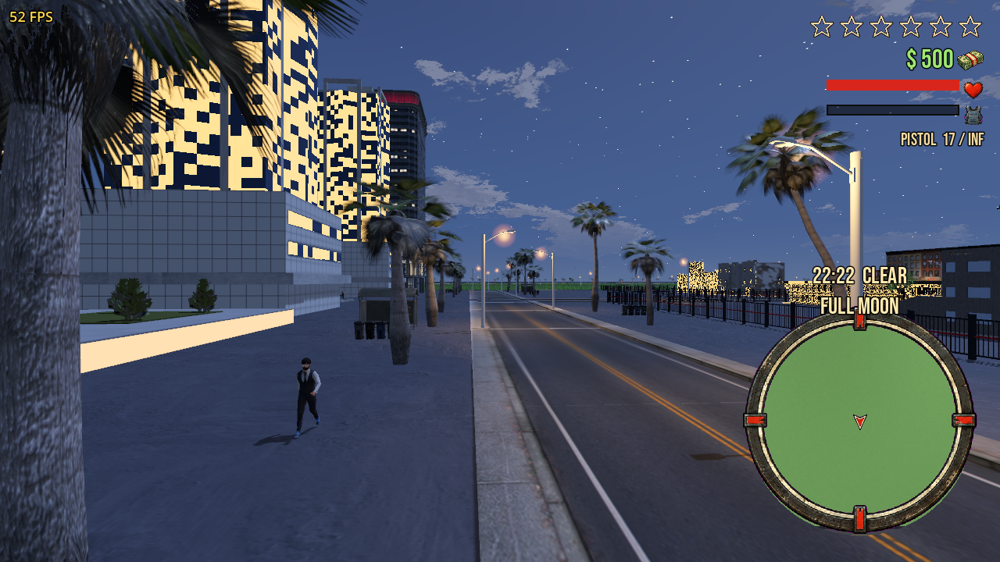
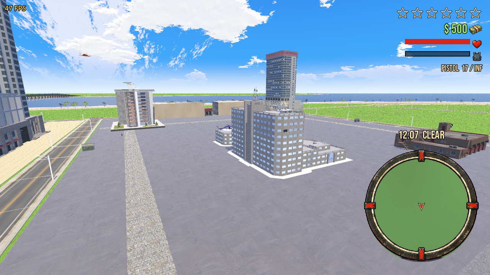
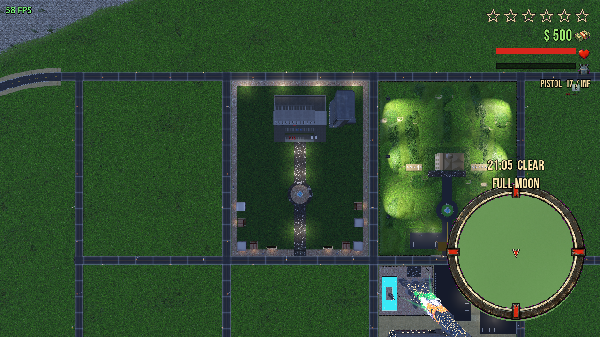
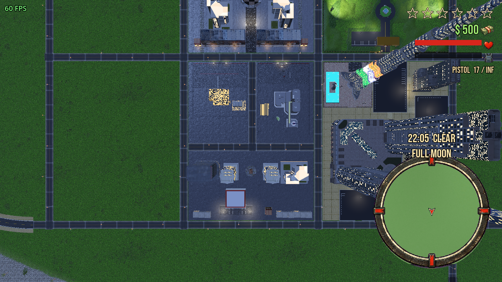

# 🌆 Redline Heights

<div align="center">



[](https://godotengine.org)
[](#-quick-start)
[](#-licensing--credits)
[](https://github.com/skrehanahamed/Redlines_Heights/actions/workflows/ci.yml)
[](#-contributing)

**An open-world retro 3D crime action and driving game inspired by classic PS2 era titles, built with Godot 4 and GDScript.**

[Features](#-game-features) • [Screenshots](#-screenshots) • [Controls](#-controls) • [Quick Start](#-quick-start) • [Architecture](#-project-architecture) • [Web Showcase](#-3d-asset-studio-web-viewer)

</div>

---

## 📖 Overview

**Redline Heights** brings the golden era of open-world urban driving games back to life. Set across the neon-lit boulevards, coastal highways, and towering downtown skyline of Redline Island, the game features drivable PSX-style vehicles with arcade physics, a living AI traffic system, responsive pedestrian crowds, an active 5-star police pursuit system, and an authentic retro soundtrack.

Whether you are cruising down the oceanfront boulevard, getting into high-speed pursuits with city cruisers, taking the underground transit line, or walking through bustling shop blocks, Redline Heights is engineered with lightweight, optimized modular systems in Godot.

---

## 📸 Screenshots

<div align="center">
  <table>
    <tr>
      <td width="50%">
        
        <p align="center"><b>🚔 High-Speed Police Pursuits & Wanted System</b></p>
      </td>
      <td width="50%">
        
        <p align="center"><b>🌙 Dynamic Day/Night Cycle & Glowing Cityscape</b></p>
      </td>
    </tr>
    <tr>
      <td width="50%">
        
        <p align="center"><b>🗺️ Modular Road Grid & Redline Island</b></p>
      </td>
      <td width="50%">
        
        <p align="center"><b>🚗 PSX Retro Vehicle Physics & Downtown Blocks</b></p>
      </td>
    </tr>
  </table>
</div>

---

## ⚡ Game Features

### 🚗 Vehicle Physics & Fleet
- **8+ Drivable PSX Cars**: Sedans, station wagons, hatchbacks, utility vans, Liberty City-style taxis, muscle old-timers, box trucks, and sports coupes.
- **Realistic Arcade Dynamics**: Tuned suspension, acceleration, tire skids, crash damage, metal impact sounds, working headlights, taillights, brake lights, and vehicle horn.
- **Emergency Recovery**: Dedicated flip-upright recovery if you roll over.
- **~85 Parked Vehicles**: Scattered across parking lots, curbs, and alleyways for instant commandeering.

### 🚦 Living City & Traffic AI
- **Smart Road Grid**: Intersections, lane markings, pedestrian crosswalks, street lamps, and road kits.
- **Autonomous Traffic**: AI cars obey traffic corridors, make turns at four-way junctions, and brake for obstacles.
- **Dynamic Pedestrians**: Over 80+ pedestrian model variants wandering sidewalks, reacting to gunfire, and fleeing high-speed crashes.

### ⭐️ Law Enforcement & Wanted Level
- **5-Star Escalation**: Committing crimes or hitting pedestrians alerts the police department.
- **Aggressive Pursuits**: Police cruisers spawn with sirens and flashing lights to box you in.
- **Arrest & Respawn Flow**: Full *"BUSTED"* and *"DOWN AND OUT"* mechanics with hospital/station respawning and fines.

### 🔫 Combat & Arsenal
- **On-Foot Locomotion**: Retargeted animations for walking, sprinting, crouching, jumping, and swimming.
- **Weapons System**: Fists, melee baseball bats, 9mm pistols, SMGs, shotguns, assault rifles, sniper rifles with custom scopes, grenades, and molotov cocktails.
- **Gun Shop**: Enterable Redline Ammo storefront with an interactive purchase catalog.

### 🌊 Environmental Systems & Beach Life
- **Custom Shaders**: Ocean swells with distance-to-shore foam simulation, real-time rain ring ripples, and multi-layer terrain blending (grass, dirt, sand).
- **Coastal Wildlife**: Leaping dolphins, sea turtles, hammerhead sharks, manta rays, coastal pelicans, and crabs along the shoreline.
- **Underground Transit**: Fully functional underground metro system connecting the island to mainland stations.
- **Atmospheric Audio**: Multi-channel in-car radio featuring 9 CC0 music tracks, 3D spatial engine loops, and sirens.

---

## 🎮 Controls

### On Foot
| Key / Input | Action |
|---|---|
| <kbd>W</kbd> <kbd>A</kbd> <kbd>S</kbd> <kbd>D</kbd> | Move Character |
| <kbd>Shift</kbd> | Sprint |
| <kbd>Ctrl</kbd> | Walk Slowly / Dive (in water) |
| <kbd>Space</kbd> | Jump |
| <kbd>Mouse</kbd> | Look Around (Orbit Camera) |
| <kbd>Left Click</kbd> | Punch / Fire Equipped Weapon |
| <kbd>Right Click</kbd> | Aim Weapon |
| <kbd>Q</kbd> | Cycle Weapon (Fists ➔ Pistol ➔ Arsenal) |
| <kbd>T</kbd> | Reload Weapon |
| <kbd>E</kbd> | Enter / Exit Nearest Vehicle |

### In Vehicle
| Key / Input | Action |
|---|---|
| <kbd>W</kbd> / <kbd>S</kbd> | Accelerate / Reverse |
| <kbd>A</kbd> / <kbd>D</kbd> | Steer Left / Right |
| <kbd>Space</kbd> | Handbrake / Drift |
| <kbd>L</kbd> | Toggle Headlights |
| <kbd>H</kbd> | Sound Horn |
| <kbd>R</kbd> | Car Radio On / Next Station |
| <kbd>Backspace</kbd> | Flip Vehicle Upright |
| <kbd>E</kbd> | Exit Vehicle |

### Game & Dev Shortcuts
| Key / Input | Action |
|---|---|
| <kbd>Esc</kbd> | Pause Menu (Resume / Settings / Quit) |
| <kbd>F11</kbd> | Toggle Fullscreen / 1080p Windowed |
| <kbd>F1</kbd> / <kbd>F3</kbd> | Dev Help / Engine Performance Stats |
| <kbd>F4</kbd> | Toggle Free Camera Mode |
| <kbd>F5</kbd> | God Mode |
| <kbd>F7</kbd> / <kbd>F9</kbd> | Teleport / Spawn Vehicle |
| <kbd>F10</kbd> / <kbd>G</kbd> | Unlock All Weapons / Weapon Grip Editor |

---

## 🚀 Quick Start

### Prerequisites
- **[Godot Engine 4.7+](https://godotengine.org)** (Standard 64-bit build)
- **Make** (installed by default on macOS and Linux)

### Running the Game

Clone the repository and launch via Makefile:

```bash
# 1. Clone the repository
git clone git@github.com:skrehanahamed/Redlines_Heights.git
cd Redlines_Heights

# 2. Run the game (Redline Island - fast boot)
make run

# 3. Or play the full expansive world
make full
```

### Useful Make Targets
```bash
make run       # Play Island Only (Fast startup)
make full      # Play full world map
make edit      # Open project directly in the Godot Editor
make test      # Run headless sanity and vehicle physics tests
make import    # Re-import all assets headlessly
```

---

## 🏗️ Project Architecture

```
Redline_Heights/
├── project.godot            # Main Godot project manifest
├── scenes/
│   ├── game.tscn            # Master game world scene
│   └── ...                  # UI, HUD, and vehicle scenes
├── scripts/
│   ├── game.gd              # Autoload global state (money, wanted, health)
│   ├── world.gd             # Procedural island & town generator
│   ├── car.gd               # Vehicle physics, lights, camera & audio
│   ├── player.gd            # Hero locomotion, combat, weapons, swimming
│   ├── traffic_manager.gd   # AI traffic spawning & grid navigation
│   ├── ped_manager.gd       # Pedestrian AI population & crowd control
│   ├── police_manager.gd    # Wanted escalation & squad car pursuit logic
│   ├── weather.gd           # Day/night cycle & atmospheric lighting
│   └── hud.gd               # Mini-map, health/armor bars, speedo, star rating
├── shaders/
│   ├── sea.gdshader         # Dynamic water swells, foam & rain ripples
│   └── terrain.gdshader     # Multi-texture terrain splatting
├── assets/                  # 3D models (GLB), textures, audio (OGG), UI icons
└── tools/                   # Model sheet generators and dev utilities
```

---

## 🌐 3D Asset Studio (Web Viewer)

The repository includes a standalone Three.js asset inspector in `index.html`. It lets you preview 3D models, inspect wireframes, test audio loops, and view texture materials directly in your browser without launching the Godot editor.

To launch:
```bash
# Start a simple local HTTP server from the project root
python3 -m http.server 8080
```
Open `http://localhost:8080` in your web browser.

---

## 🤝 Contributing

Contributions, bug reports, and suggestions are welcome!
1. Check the open [Issues](https://github.com/skrehanahamed/Redlines_Heights/issues).
2. Read the [Bug Report](.github/ISSUE_TEMPLATE/bug_report.yml) or [Feature Request](.github/ISSUE_TEMPLATE/feature_request.yml) guidelines.
3. Fork the repository, create your feature branch, and submit a PR using the [Pull Request Template](.github/PULL_REQUEST_TEMPLATE.md).

> **Note on Assets**: All contributions involving 3D models, textures, animations, or sound effects **must be strictly CC0 or CC-BY licensed**. Proprietary or ripped game assets are strictly prohibited.

---

## ⚖️ Licensing & Credits

- **Game Engine & Code**: GDScript and architecture under open permissive terms.
- **3D Assets & VFX**: Built using community packs from Kenney.nl, Quaternius (Universal Animation Library), ambientCG, Poly Haven, and Sketchfab creators under CC0 and CC-BY licenses.
- **Audio & Music**: CC0 sound effects and community radio tracks.
